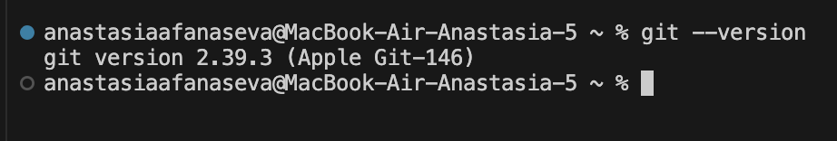
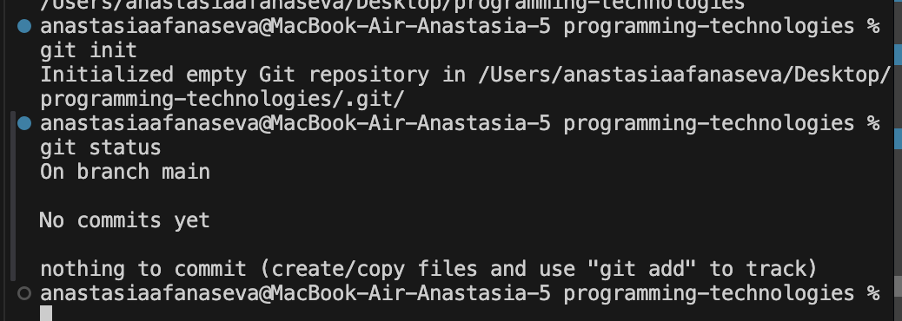
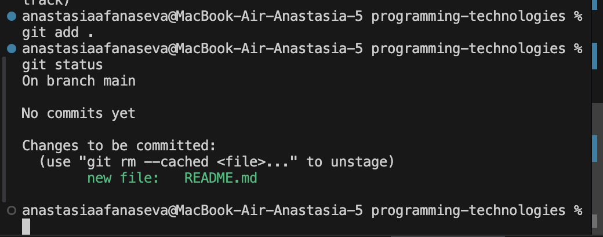
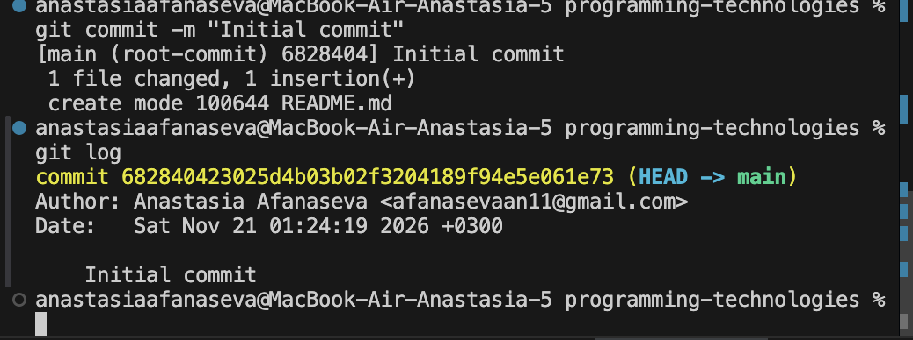
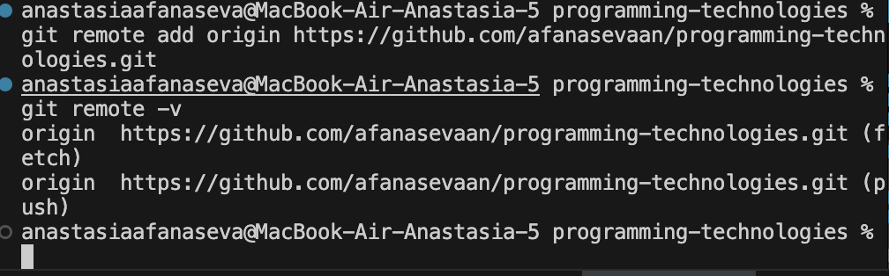
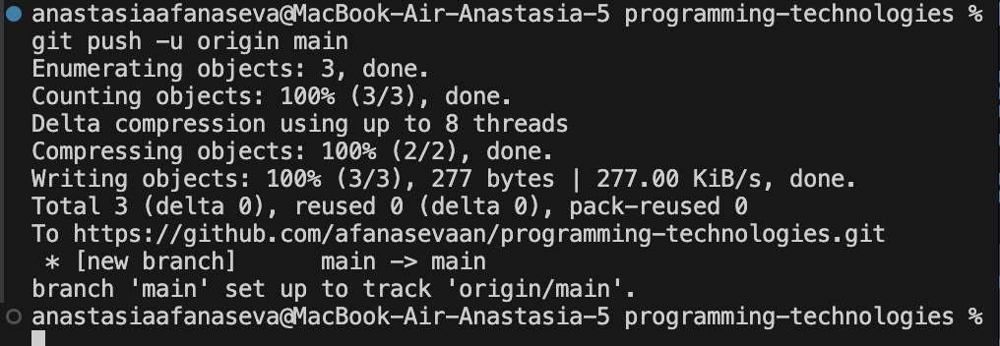

# Лабораторная работа №1

Основы работы с системой контроля версий Git

## 1. Цель работы

Изучить основные команды Git, научиться создавать репозиторий, сохранять изменения и отправлять их на GitHub.

## 2. Ход работы

### 2.1. Проверка установки Git

Проверила установленную версию Git командой:

`git --version`

Результат: `git version 2.39.3`

### 2.2. Создание локального репозитория

Создала папку проекта `programming-technologies` и выполнила команды:

`git init`

`git status`

После инициализации был создан локальный репозиторий с веткой `main`.

### 2.3. Добавление файлов

Создала файл `README.md` и добавила его в индекс:

`git add .`

Проверила состояние файлов:

`git status`

Файл был подготовлен к созданию коммита.

### 2.4. Создание коммита

Проверила настройки пользователя:

`git config --global user.name`

`git config --global user.email`

Создала первый коммит:

`git commit -m "Initial commit"`

Посмотрела историю коммитов:

`git log`

Коммит был успешно создан.

### 2.5. Подключение GitHub

Создала удалённый репозиторий на GitHub.

Подключила его командой:

`git remote add origin https://github.com/afanasevaan/programming-technologies.git`

Проверила подключение:

`git remote -v`

### 2.6. Отправка изменений

Отправила изменения на GitHub:

`git push -u origin main`

После авторизации файлы были успешно загружены.

## 3. Вывод

В ходе работы я создала локальный репозиторий Git, добавила файл, сделала первый коммит и отправила изменения на GitHub.

[Назад к списку лабораторных](../../README.md)
